<div align="center">

# MaSci — AI-Powered K-12 E-Learning Platform

[](https://spring.io/projects/spring-boot)
[](https://kotlinlang.org/)
[](https://dagger.dev/)
[](https://reactivex.io/)
[](https://react.dev/)
[](https://www.mysql.com/)
[](https://firebase.google.com/)
[](https://ai.google.dev/)

**Full-stack E-Learning system for K-12 students with a Socratic AI Tutor, gamified quizzes, and real-time progress tracking.**

*3 integrated sub-projects · 22 REST API controllers · 31 database entities · Android + React + Spring Boot*

</div>

---

## 📱 Demo — App Screenshots

### Authentication Flow
> JWT-secured registration with Email OTP verification and password reset

| Onboarding | Welcome | Register | Login |
|:---:|:---:|:---:|:---:|
| 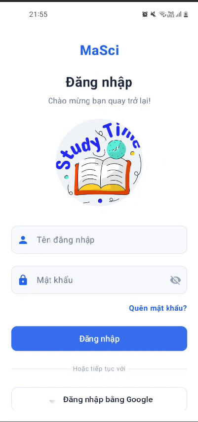 | 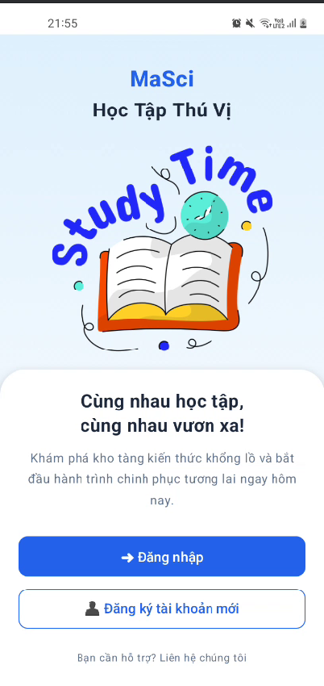 | 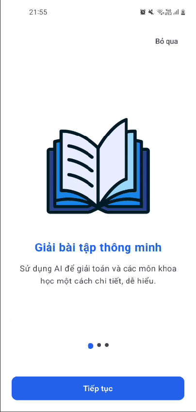 | 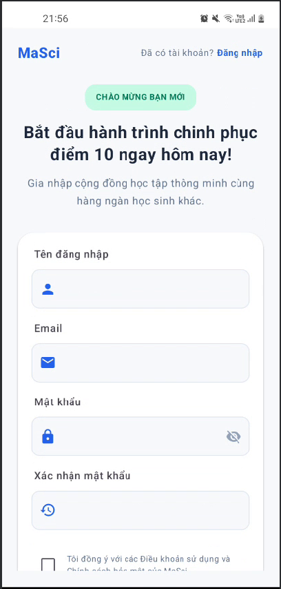 |

### Learning Experience
> Structured content delivery with LaTeX math rendering, Progress tracking, and Daily Streak gamification

| Home Dashboard | Profile & Grade | Theory List | Theory Detail (LaTeX) |
|:---:|:---:|:---:|:---:|
| 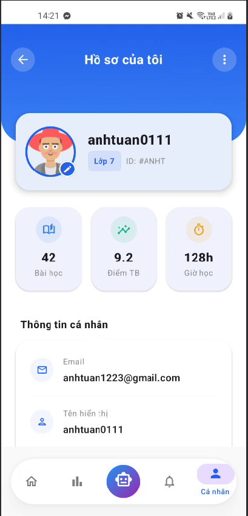 | 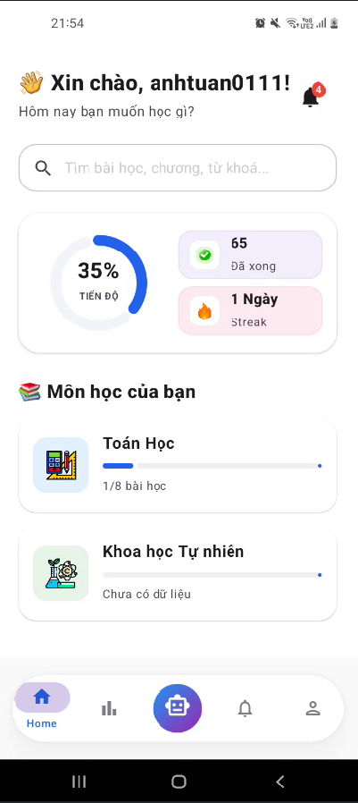 | 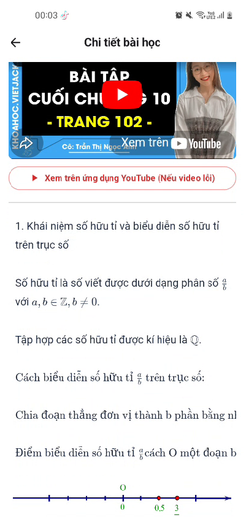 | 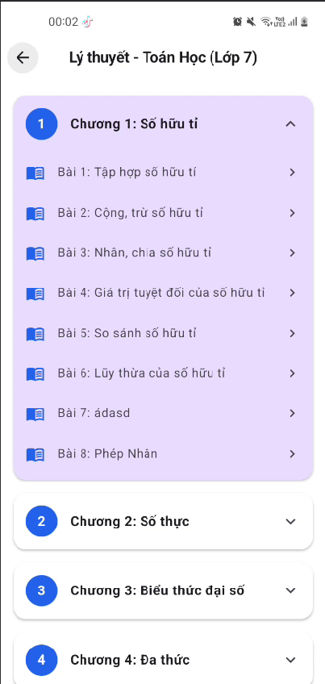 |

### AI Features
> Socratic AI Tutor (Gemini) — guided hints only, never direct answers · Image-based Exercise Grading

| AI Tutor Chat | Exercise Submission | Camera Capture | Notifications |
|:---:|:---:|:---:|:---:|
| 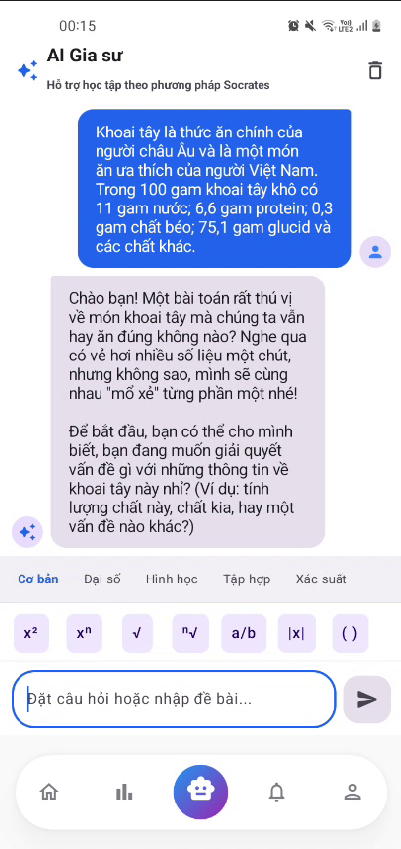 | 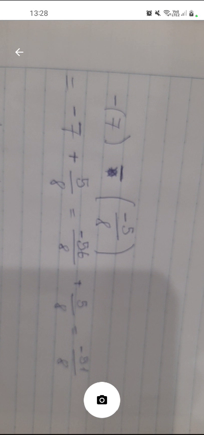 | 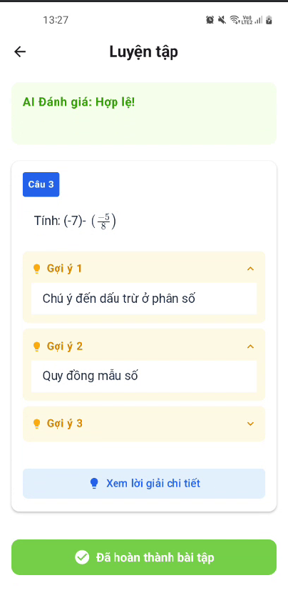 | 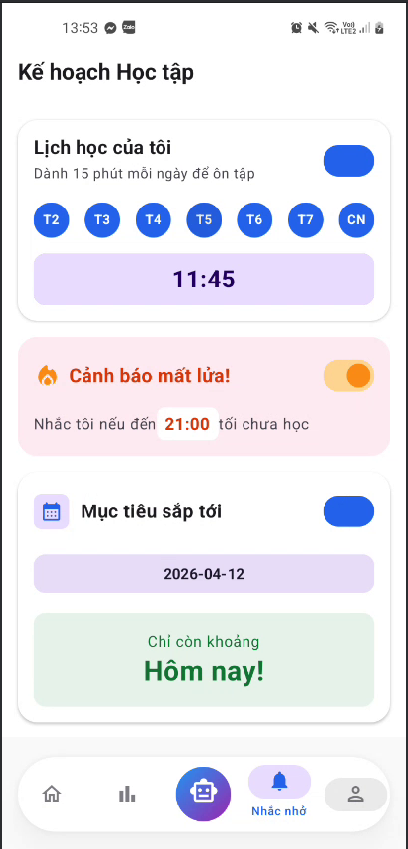 |

### Quiz System
> Timed MCQ quizzes with countdown timer, loss-aversion UX, and per-question result review

| Quiz Execution | Quiz Result |
|:---:|:---:|
| 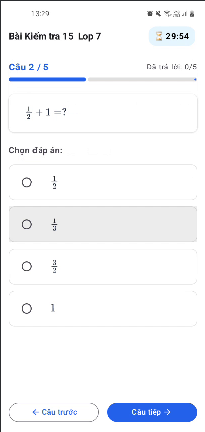 | 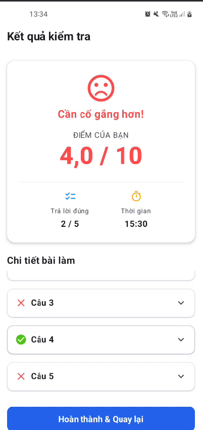 |

---

### 🖥️ Web Admin Panel
> React 19 + Ant Design 6 — Full course & user management with CKEditor 5 + MathLive LaTeX input

| Analytics Dashboard | Course Content Editor |
|:---:|:---:|
| 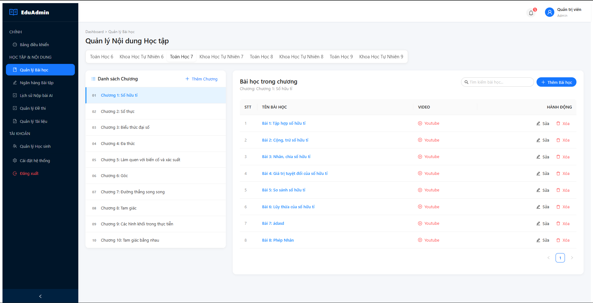 | 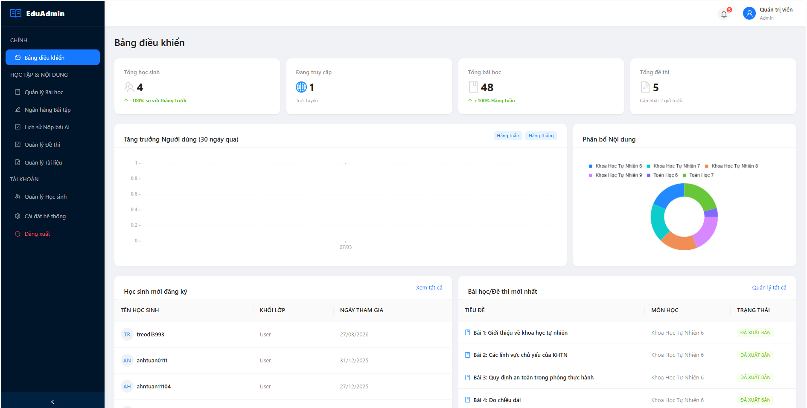 |

| Lesson CRUD | User Management |
|:---:|:---:|
| 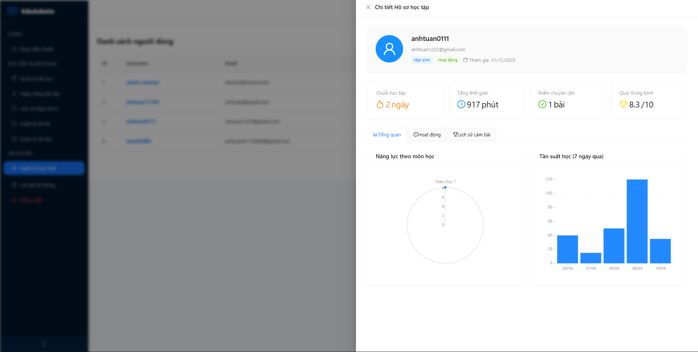 | 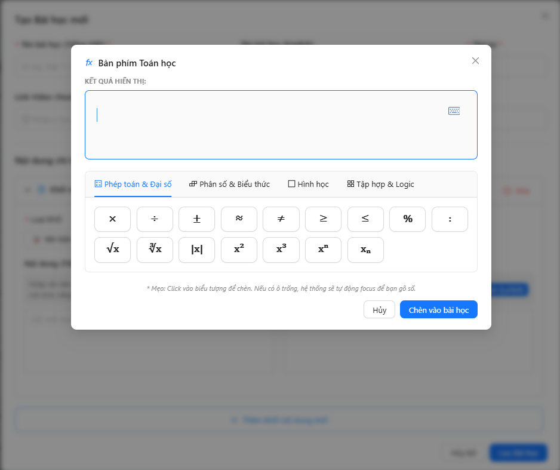 |

| Submission Review | Quiz Management |
|:---:|:---:|
| 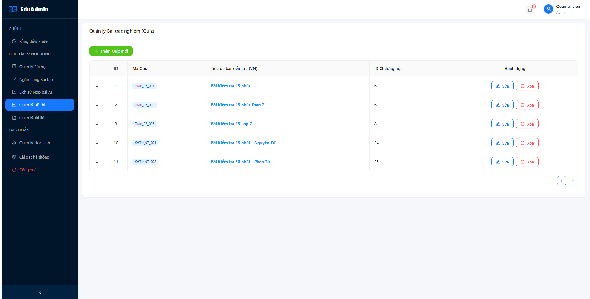 | 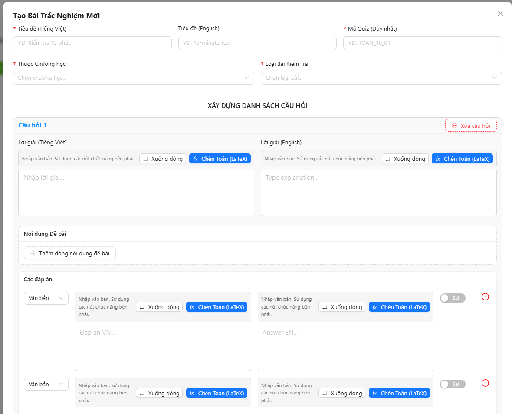 |

---

## What Is This Project?

**MaSci** is a production-grade E-Learning platform for Vietnamese secondary school students (grades 6–12). It was built as a full-stack Final Year Project, covering all layers of modern software engineering:

- **Android mobile app** for students — learn theory, submit exercises with AI grading, take quizzes, and chat with an AI Tutor
- **React web dashboard** for administrators — manage courses, users, quizzes, and monitor submissions
- **Spring Boot REST API** — the backend powering all features, secured with JWT, backed by MySQL and Redis

> **What makes it interesting technically:**
> Students photograph their handwritten answers. The image is uploaded directly to Firebase Storage via a **server-generated pre-signed URL** (offloading backend memory), then the Gemini API analyzes the image and returns AI-generated feedback — all within ~1.2 seconds end-to-end.

---

## Key Technical Highlights

| What | How |
|---|---|
| **AI Image Grading** | Handwritten exercise photos → Firebase Signed URL upload (bypass server) → Gemini Vision AI validates the answer |
| **Socratic AI Tutor** | Multi-turn chat with Gemini, constrained via system prompt to only give guided hints — never direct answers |
| **LaTeX Math Rendering** | Lesson content stored as LaTeX strings, rendered natively on Android via Markwon + ext-latex (Canvas-level) |
| **Dependency Injection** | **Dagger 2 / Hilt** modular DI across Clean Architecture layers with scoped components (`@Singleton`, `@ViewModelScoped`) |
| **Async & Reactive Flow** | Asynchronous operations and non-blocking I/O using **Kotlin Coroutines** (structured concurrency) & **RxJava / Flow** pipelines |
| **Background Processing** | Guaranteed, battery-efficient background task scheduling and study reminders using Android **WorkManager** |
| **JWT + Redis Blacklist** | Stateless JWT with Redis-backed token blacklist for secure logout and instant session invalidation |
| **Real-time Notifications** | Firebase Cloud Messaging (FCM) push + WebSocket (STOMP) for in-app real-time alerts |
| **Daily Streak Gamification** | Cron scheduler tracks daily activity; streak reset if student misses a day; loss-aversion UX in Quiz timer |
| **Dynamic Progress Tracking** | Per-subject progress calculated server-side from `lesson_completions`, exposed via REST, animated in Vico charts |
| **MVVM + Clean Architecture** | Robust separation of concerns via MVVM + Repository pattern, Material Design 3, and reactive UI state |

---

## System Architecture

```
┌──────────────────────────────────────────────────────────┐
│                      CLIENT LAYER                        │
│                                                          │
│  📱 Android App (Kotlin / Java)  🖥️ Web Admin (React 19)  │
│  Jetpack Compose + Material 3    Ant Design 6 + Vite     │
│  Retrofit + Dagger/Hilt + RxJava Axios + React Router    │
│  Coroutines + WorkManager                                │
└────────────┬─────────────────────────────┬───────────────┘
             │        REST API / JWT        │
             ▼                             ▼
┌──────────────────────────────────────────────────────────┐
│              BACKEND (Spring Boot 3.2 · Java 17)         │
│                                                          │
│  22 Controllers → 21 Services → JPA Repositories        │
│  Spring Security + JWT Filter + CORS Config              │
│  MySQL 8.0 (31 Entities) + Redis (Session Cache)         │
│  WebSocket (STOMP) · Scheduled Tasks (Cron)              │
└───────────────────────┬──────────────────────────────────┘
                        │  External Services
          ┌─────────────┼──────────────────┐
          ▼             ▼                  ▼
   🔥 Firebase      🤖 Gemini AI      📧 Gmail SMTP
   Storage + FCM    (AI Tutor +        (OTP Email
   (Images, PDFs)    Image Grading)     Verification)
```

---

## Project Structure

```
Final_Project/
├── finalProject_BE/        # Spring Boot REST API (Java 17)
├── finalProject_Mobileapp/ # Android App (Kotlin + Jetpack Compose)
├── finalProject_Webadmin/  # Web Admin Panel (React 19 + Ant Design)
└── screenshots/            # App screenshots organized by feature
    ├── mobile/
    └── webadmin/
```

---

## Tech Stack

### Backend — `finalProject_BE`

| Layer | Technology |
|---|---|
| Framework | Spring Boot 3.2.5 (Java 17) |
| Database | MySQL 8.0 · Spring Data JPA / Hibernate |
| Cache | Redis (JWT token blacklist) |
| Security | Spring Security · JJWT 0.11.5 |
| Real-time | WebSocket (STOMP protocol) |
| File Storage | Firebase Admin SDK · Pre-signed URL pattern |
| AI | Google Gemini API (text generation + vision) |
| Push Notification | Firebase Cloud Messaging (FCM) |
| Email | Spring Mail · Gmail SMTP (OTP verification) |
| Scheduler | Spring `@Scheduled` · daily streak Cron job |
| Build | Maven |

### Android App — `finalProject_Mobileapp`

| Layer | Technology |
|---|---|
| **Language** | **Kotlin** · **Java** |
| **UI & UX** | **Jetpack Compose** · **Material Design 3** (Material You) |
| **Architecture** | **MVVM** · **Clean Architecture** · **Repository Pattern** |
| **Dependency Injection** | **Dagger 2** · **Hilt** (Modular DI, `@Module`, `@Provides`, `@InstallIn`, scoped components) |
| **Concurrency & Async** | **Kotlin Coroutines** (`Dispatchers.IO` / `Main`, structured concurrency, `viewModelScope`) |
| **Reactive Streams** | **RxJava 3** · **Kotlin Flow** / **StateFlow** (reactive data streams, observable state pipelines) |
| **Background Processing** | **WorkManager** (Periodic task scheduling, guaranteed background execution, study reminders) |
| **Networking** | **Retrofit 2** · **OkHttp** (REST client, Interceptors, reactive adapters) |
| **Local Storage** | **DataStore Preferences** (encrypted JWT persistence, user settings) |
| **Camera** | **CameraX** (exercise image capture) |
| **Math Rendering** | **Markwon** + **ext-latex** (LaTeX → Android Canvas) |
| **Charts** | **Vico Charts** (animated progress visualization) |
| **Push Notifications** | **Firebase Cloud Messaging (FCM)** |
| **Media** | **YouTube Android Player** · **Coil** (image loading) |
| **Dev Tools & VCS** | **Android Studio** · **Git** |
| **Min SDK** | API 24 (Android 7.0) |

#### 📱 Android Architecture & Core Technologies Breakdown

- **Dagger 2 / Hilt (Dependency Injection):**
  - Fully decoupled, modular architecture adhering to Clean Architecture principles.
  - Dependency injection graph structured via `@InstallIn(SingletonComponent::class)` for application-wide singletons (Retrofit network services, repositories, DataStore) and `@ViewModelScoped` for ViewModel-specific dependencies.
- **Kotlin Coroutines (Asynchronous Programming):**
  - Lightweight concurrency with structured concurrency management via `viewModelScope`.
  - Seamless background thread dispatching (`Dispatchers.IO`) for network requests and image processing, safely updating UI state on `Dispatchers.Main`.
- **RxJava 3 & Kotlin Flow (Reactive Data Streams):**
  - Reactive event pipelines and observable data streams for real-time synchronization between the data layer and UI state.
  - Event debouncing and stream transformation for responsive search and state updates.
- **Android WorkManager (Guaranteed Background Tasks):**
  - Battery-conscious, persistent background task scheduling using `PeriodicWorkRequestBuilder` with constraints (network connectivity, device idle state).
  - Handles automated study schedule reminders, daily streak notifications, and background data synchronization that persist across device reboots and app restarts.
- **Retrofit 2 & Material Design 3:**
  - Type-safe HTTP client with custom OkHttp interceptors for automatic JWT authentication token injection and language switching.
  - Modern, accessible, and responsive user interface built using Google's **Material Design 3** design system.

### Web Admin — `finalProject_Webadmin`

| Layer | Technology |
|---|---|
| Framework | React 19 + Vite (Rolldown bundler) |
| UI | Ant Design 6 · @ant-design/plots (charts) |
| Routing | React Router DOM v7 |
| HTTP | Axios (interceptors for JWT) |
| Rich Text | CKEditor 5 |
| Math Input | MathLive (WYSIWYG LaTeX editor) · KaTeX (rendering) |
| Auth State | React Context + JWT Decode |

---

## Feature Overview

### Student Mobile App

| Feature | Details |
|---|---|
| **Registration & Login** | Email OTP verification · Forgot/Reset password flow |
| **Grade & Subject Selection** | Content scoped to grades 6–12, filtered by subject |
| **Theory Learning** | Lessons with embedded YouTube videos, PDF viewer, LaTeX-rendered math |
| **Exercise Submission** | Photograph handwritten solutions → Gemini Vision AI grades the answer |
| **AI Tutor Chat** | Socratic multi-turn conversation — guided hints only; math symbol keyboard for formula input |
| **Quiz System** | Timed MCQ quizzes with countdown timer, result history, per-question review |
| **Dashboard** | Animated progress charts per subject, daily streak, average score |
| **Search** | Full-text search across lessons and subjects, filtered by grade (debounced with RxJava / Flow) |
| **Study Reminders & Background Sync** | Personalized study schedule and periodic reminders reliably orchestrated via **WorkManager** |
| **Async Operations & Reactive UI** | Non-blocking API requests, background computations, and responsive UI state powered by **Kotlin Coroutines** & **RxJava** |
| **Real-time Push** | FCM push + in-app WebSocket alerts |

### Admin Web Panel

| Feature | Details |
|---|---|
| **Dashboard** | Live stats: total users, lessons, exercises; engagement charts |
| **Course Management** | Full CRUD: Subjects → Chapters → Lessons → Content (text, video, PDF) |
| **Exercise Management** | CKEditor 5 rich text + MathLive LaTeX input |
| **Submission Review** | Browse student submissions with AI grading results |
| **Quiz Management** | Question banks, create quizzes per subject/grade/difficulty |
| **User Management** | View accounts, activate/suspend users, reset streaks |
| **Document Management** | Upload and manage PDF materials on Firebase Storage |

### Backend API (22 Controllers)

| Controller | Responsibility |
|---|---|
| `AuthController` | Register, Login, OTP verify, Forgot/Reset password |
| `UserController` | User profile CRUD |
| `AdminController` | Admin-scoped user operations |
| `AdminDashboardController` | Aggregated analytics endpoints |
| `AdminQuizController` | Quiz and question bank management |
| `AdminExerciseController` | Exercise CRUD |
| `AdminSubmissionController` | View & manage student submissions |
| `AdminChapterController` / `AdminLessonController` | Content hierarchy management |
| `ExerciseController` | Student exercise fetch and submit |
| `QuizUserController` | Student quiz taking and result history |
| `TheoryUserController` | Theory content delivery |
| `LessonProgressController` | Mark complete, fetch subject overview with chapter/lesson counts |
| `AiTutorController` | Gemini chat session management |
| `NotificationController` | Push notification dispatch |
| `DocumentController` | PDF upload and listing |
| `UploadController` | Firebase pre-signed URL generation |
| `SearchController` | Full-text search across content |
| `StatisticsController` | Student learning statistics |
| `UserActivityController` | Daily activity logging |
| `UserReminderSettingController` | Study reminder preferences |

---

## Database Schema (31 Entities)

| Group | Tables |
|---|---|
| **Auth & Users** | `users`, `student_profiles`, `registration_otps`, `password_reset_tokens` |
| **Course Content** | `subjects`, `chapters`, `lessons`, `lesson_contents` |
| **Assessment** | `exercises`, `exercise_solutions`, `exercise_submissions` |
| **Quiz** | `quizzes`, `questions`, `question_contents`, `choices`, `quiz_results` |
| **Documents** | `documents` |
| **Progress** | `progresses`, `lesson_completions` |
| **AI** | `ai_chat_sessions`, `ai_chat_messages` |
| **Notifications** | `notifications`, `user_reminder_settings` |
| **Activity** | `user_activities` |

---

## Authentication Flow

```
POST /auth/register  →  Email OTP sent via Gmail SMTP
POST /auth/verify-otp  →  Account activated
POST /auth/login  →  JWT Access Token returned
  ↓
Token stored:
  Android → DataStore Preferences (encrypted)
  Web     → LocalStorage
  ↓
Every API request:  Authorization: Bearer <token>
  ↓
Spring Security JWT Filter  →  Redis blacklist check  →  Grant / Deny
  ↓
POST /auth/logout  →  Token added to Redis blacklist (invalidated immediately)
```

---

## Local Setup

### Requirements

- Java 17+ · Maven
- Node.js 18+
- MySQL 8.0 · Redis
- Android Studio Hedgehog or later · Git
- Firebase project (Storage + FCM enabled)
- Google Gemini API key

### 1. Backend

```bash
cd finalProject_BE/finalProject

# Create MySQL database
mysql -u root -p -e "CREATE DATABASE e_learningdb;"

# Configure src/main/resources/application.properties:
spring.datasource.url=jdbc:mysql://localhost:3306/e_learningdb
spring.datasource.username=root
spring.datasource.password=YOUR_PASSWORD
app.jwt.secret=YOUR_JWT_SECRET
gemini.api.key=YOUR_GEMINI_API_KEY
spring.mail.username=YOUR_GMAIL
spring.mail.password=YOUR_APP_PASSWORD

# Place firebase-service-account.json in src/main/resources/

# Start Redis, then:
./mvnw spring-boot:run
# → http://localhost:8080
```

### 2. Web Admin

```bash
cd finalProject_Webadmin/web-admin
npm install

# Create .env:
VITE_API_BASE_URL=http://localhost:8080

npm run dev
# → http://localhost:5173
```

### 3. Android App

```bash
# Open finalProject_Mobileapp/ in Android Studio
# Sync Gradle dependencies

# In NetworkModule.kt set:
BASE_URL = "http://10.0.2.2:8080/"   # emulator
# or your LAN IP for a physical device

# Add google-services.json (from Firebase Console) to app/

# Run (Shift+F10)
```

---

## Source Code Layout

### Backend
```
src/main/java/vn/anhtuan/finalProject/
├── controller/     # 22 REST controllers
├── service/        # 21 services + impl/
├── entity/         # 31 JPA entities
├── dto/            # Request & Response DTOs
├── repository/     # Spring Data JPA repositories
├── security/       # JWT filter + Spring Security config
├── config/         # WebSocket, CORS, Firebase
├── scheduler/      # Cron jobs (daily streak reset)
├── exception/      # Global exception handler
└── utils/
```

### Android
```
app/src/main/java/com/example/finalproject/
├── ui/
│   ├── screens/        # auth, home, theory, exercise, quiz, ai, dashboard, profile...
│   ├── viewmodel/      # MVVM ViewModels (Coroutines viewModelScope, StateFlow, RxJava)
│   ├── navigation/     # AppNavHost + AppRoutes
│   ├── components/     # Reusable Compose components (Material Design 3)
│   └── theme/          # Material 3 theme
├── data/
│   ├── remote/         # Retrofit 2 service + response models
│   ├── local/          # DataStore Preferences
│   └── repository/     # Data repositories & data sources
├── domain/             # Use Cases & business logic
├── di/                 # Dagger 2 / Hilt modules (@Module, @Provides, @InstallIn)
├── worker/             # WorkManager workers (StudyReminderWorker, background sync)
└── utils/              # DataStoreManager, helpers
```

### Web Admin
```
src/
├── pages/         # Auth, Dashboard, User, Course, Exercise, Submission, Quiz, Document
├── components/    # Layout (sidebar), shared UI, CKEditor wrapper
├── api/           # Axios API calls per feature
├── context/       # Auth state (React Context)
├── router/        # AppRouter + PrivateRoute guard
└── utils/
```

---

## Author

**Lê Anh Tuấn**
📧 hikatu137@gmail.com
🎓 Final Year Project — Open University Malaysia (OUM)

---

<div align="center">

*MaSci — Intelligent learning for the next generation* 🚀

</div>
