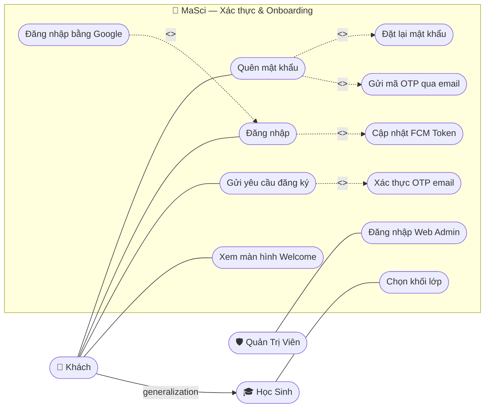
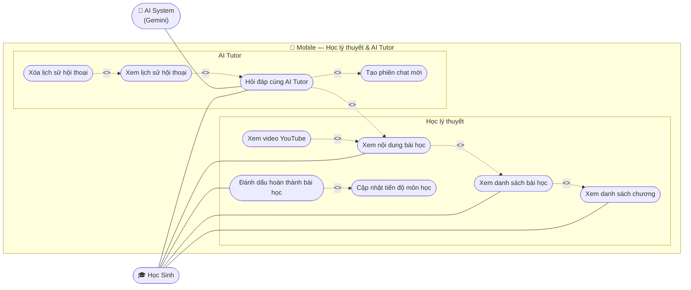
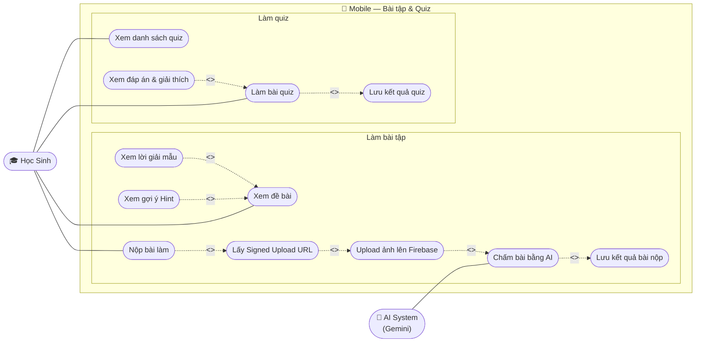
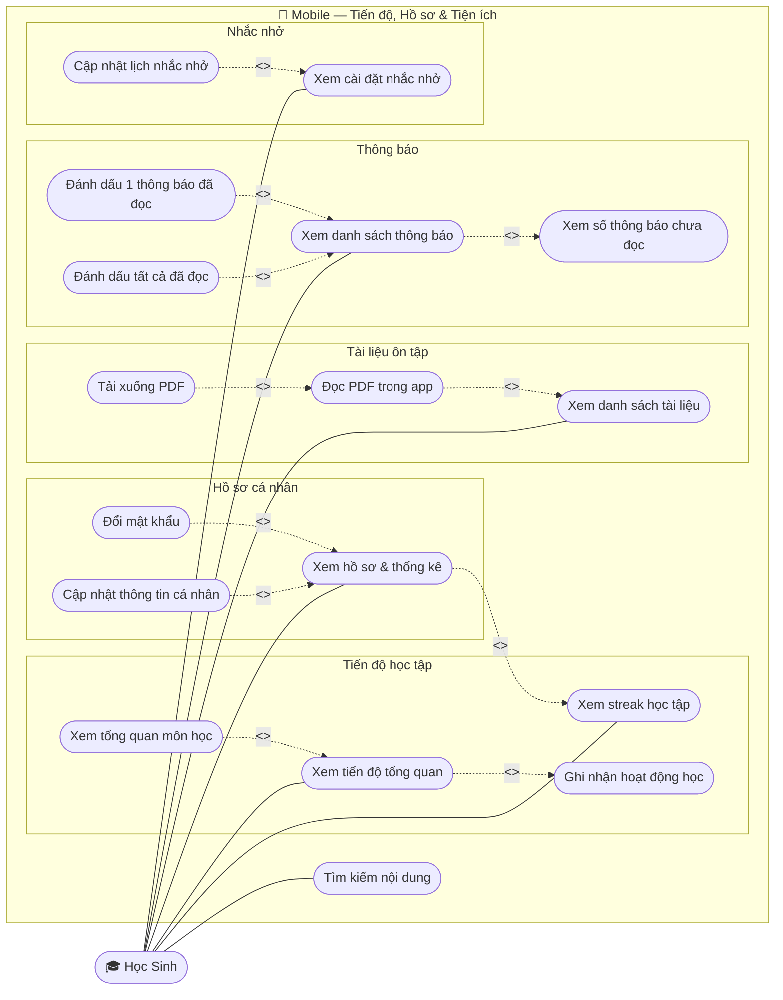
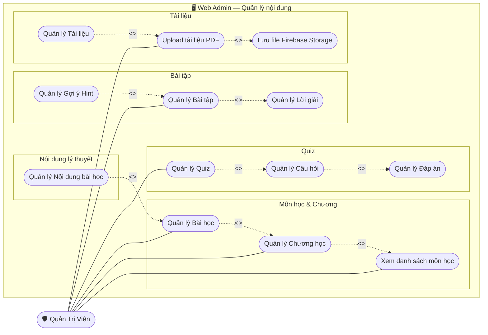
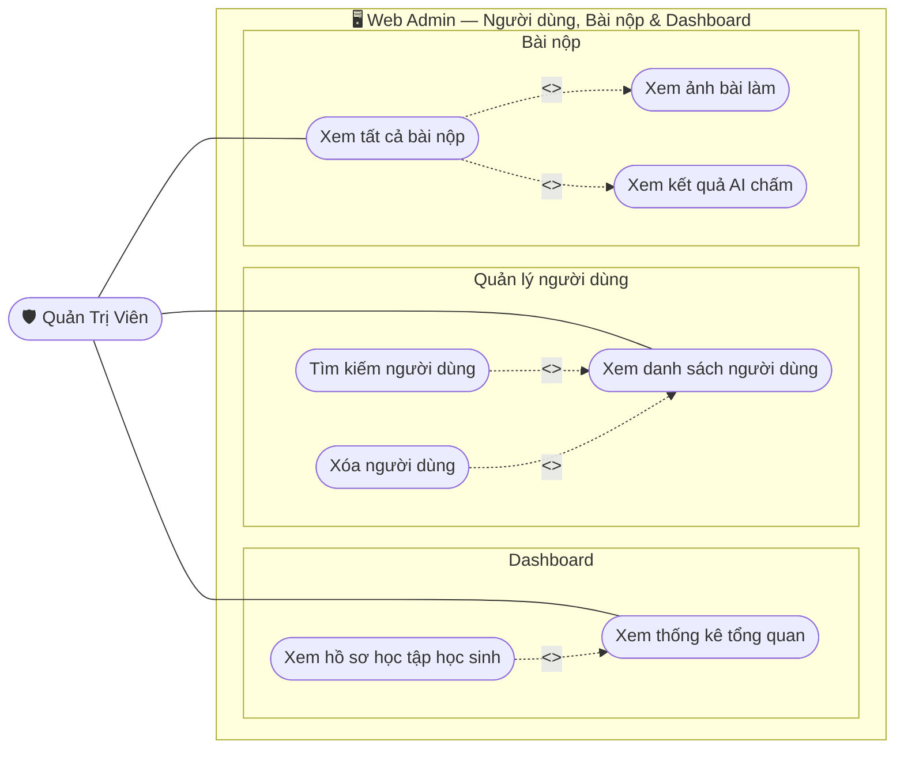

# 📋 Use Case Diagram — MaSci E-Learning (UML Chuẩn · Đã rà soát 3 nền tảng)

> **Nguồn rà soát:**
> - 📱 Android: 15 screen groups — `auth`, `class_selection`, `course`, `exercise`, `theory`, `quizes`, `ai`, `document`, `profile`, `reminder`, `search`, `dashboard`
> - 🖥️ Web Admin: 8 page groups — `Auth`, `Dashboard`, `Course`, `Exercise`, `QuizManagement`, `Document`, `Submission`, `User`
> - ⚙️ Backend: 22 controllers — `AuthController`, `UserController`, `AdminController`, `AdminDashboardController`, `AdminExerciseController`, `AdminQuizController`, `AdminSubmissionController`, `AiTutorController`, `DocumentController`, `ExerciseController`, `LessonProgressController`, `NotificationController`, `QuizUserController`, `SearchController`, `StatisticsController`, `TheoryUserController`, `UserActivityController`, `UserReminderSettingController`, `AdminChapterController`, `AdminLessonController`, `UploadController`, `TestNotificationController`

---

## 🔑 Notation UML

| Ký hiệu | Tên | Mermaid | Quy tắc |
|---|---|---|---|
| Hình người que | **Actor** | `(["👤 Tên"])` ngoài subgraph | Luôn nằm ngoài boundary |
| Hình bầu dục | **Use Case** | `([Tên UC])` | Tên bắt đầu bằng động từ |
| Hình chữ nhật | **System Boundary** | `subgraph` | Bao bọc UC |
| Nét liền | **Association** | `---` | Actor ↔ UC |
| Nét đứt `<<include>>` | **Include** | Base `-.->` Included | Bắt buộc, Base không thiếu được |
| Nét đứt `<<extend>>` | **Extend** | Extension `-.->` Base | Tùy chọn, điều kiện kích hoạt |
| Tam giác rỗng | **Generalization** | `-->` với label | Kế thừa |

---

## 📐 Diagram 1 — Xác thực & Onboarding

> **Actors:** Khách (Guest), Học Sinh (kế thừa Khách), Quản Trị Viên
> **Nguồn:** `AuthController`, `UserController`, Mobile `auth/` + `class_selection/`

**Mô tả:**
- **Khách** tương tác: Xem Welcome → Đăng ký (bắt buộc xác thực OTP) hoặc Đăng nhập (bắt buộc cập nhật FCM token để nhận push)
- **Học Sinh** sau khi đăng nhập lần đầu bắt buộc Chọn khối lớp
- **Đăng nhập Google** là phương thức thay thế tùy chọn (extend Đăng nhập)
- **Quên mật khẩu** gồm 2 bước bắt buộc nối tiếp: Gửi OTP → Đặt lại MK

---

## 📐 Diagram 2 — Mobile: Học lý thuyết & AI Tutor

> **Actors:** Học Sinh, AI System (Gemini)
> **Nguồn:** `TheoryUserController`, `AiTutorController`, `LessonProgressController`, Mobile `theory/`, `ai/`, `course/`

**Mô tả:**
- Học viên phải duyệt theo cây: **Chương → Bài học → Nội dung** (include chain)
- **Đánh dấu hoàn thành** bắt buộc gọi `POST /progress/mark-complete` (include)
- **Hỏi AI Tutor** bắt buộc tạo session (include), nhưng chỉ xảy ra khi học viên có thắc mắc (extend Xem nội dung)
- **Xem video** chỉ khi `video_url != null` (extend)
- Lịch sử chat và xóa lịch sử là tùy chọn (extend)

---

## 📐 Diagram 3 — Mobile: Bài tập & Quiz

> **Actors:** Học Sinh, AI System (Gemini)
> **Nguồn:** `ExerciseController`, `QuizUserController`, Mobile `exercise/`, `quizes/`

**Mô tả:**
- **Nộp bài** là chuỗi include bắt buộc 4 bước: Lấy URL → Upload Firebase → AI chấm → Lưu kết quả (theo thứ tự `GET /upload-url` → Firebase PUT → `POST /validate-image` → `POST /save-submission`)
- **Làm quiz** bắt buộc gọi `POST /quizzes/{id}/submit` khi hoàn thành (include)
- **Hint** và **Lời giải mẫu** là tùy chọn khi học viên cần trợ giúp (extend)
- **Xem đáp án** chỉ sau khi nộp quiz (extend)

---

## 📐 Diagram 4 — Mobile: Tiến độ, Hồ sơ & Tiện ích

> **Actors:** Học Sinh
> **Nguồn:** `LessonProgressController`, `UserController`, `UserActivityController`, `UserReminderSettingController`, `NotificationController`, `DocumentController`, `SearchController`, Mobile `profile/`, `reminder/`, `document/`, `search/`, `dashboard/`

**Mô tả:**
- **Xem tiến độ** bắt buộc ghi nhận `POST /activity/log` (include `LogActivity`)
- **Xem hồ sơ** bắt buộc hiển thị streak (`GET /activity/streak` — include)
- **Xem thông báo** bắt buộc load badge count (`GET /notifications/unread-count` — include)
- **Đọc PDF, Tải xuống, Xem tổng quan môn** là tùy chọn (extend)
- Hai hành động đọc thông báo tách riêng: đọc 1 (`PUT /{id}/read`) vs đọc tất cả (`PUT /read-all`)

---

## 📐 Diagram 5 — Web Admin: Quản lý nội dung

> **Actors:** Quản Trị Viên
> **Nguồn:** `AdminController`, `AdminChapterController`, `AdminLessonController`, `AdminExerciseController`, `AdminQuizController`, `DocumentController`, `UploadController`, Web Admin pages `Course/`, `Exercise/`, `QuizManagement/`, `Document/`

**Mô tả:**
- Quản lý nội dung theo **cây phân cấp bắt buộc**: Môn → Chương → Bài học (include chain)
- **Bài tập** bắt buộc có Lời giải (include). Gợi ý Hint là tùy chọn (extend)
- **Quiz** bắt buộc có Câu hỏi (include), Câu hỏi bắt buộc có Đáp án (include)
- **Upload tài liệu** bắt buộc lưu Firebase (include). Quản lý tài liệu sau upload là tùy chọn (extend)
- Nội dung lý thuyết chi tiết của bài học là tùy chọn — bài có thể chỉ có tiêu đề chưa có nội dung (extend)

---

## 📐 Diagram 6 — Web Admin: Người dùng, Bài nộp & Dashboard

> **Actors:** Quản Trị Viên
> **Nguồn:** `AdminController`, `AdminDashboardController`, `AdminSubmissionController`, `StatisticsController`, Web Admin pages `Dashboard/`, `User/`, `Submission/`

**Mô tả:**
- **Dashboard** (`GET /api/admin/dashboard`) tổng hợp số liệu. **Xem hồ sơ từng HS** (`GET /admin/dashboard/student/{id}`) là extend tùy chọn
- **Xem danh sách bài nộp** (`GET /api/admin/submissions`) bắt buộc hiển thị ảnh và kết quả AI — không có 2 thành phần này bài nộp không có ý nghĩa (include)
- **Tìm kiếm** và **Xóa user** là hành động tùy chọn qua danh sách user (extend)
- **Xóa user** (`DELETE /admin/users/{id}`) chỉ xảy ra khi Admin chủ động chọn

---

## 📊 Bảng tổng hợp đầy đủ

### Include — 16 quan hệ bắt buộc

| # | Base UC | Included UC | Endpoint |
|---|---|---|---|
| 1 | Gửi yêu cầu đăng ký | Xác thực OTP email | `POST /auth/register-otp` → `/verify-register` |
| 2 | Đăng nhập | Cập nhật FCM Token | `POST /users/update-fcm-token` |
| 3 | Quên mật khẩu | Gửi mã OTP qua email | `POST /auth/forgot-password` |
| 4 | Quên mật khẩu | Đặt lại mật khẩu | `POST /auth/reset-password` |
| 5 | Xem danh sách bài học | Xem danh sách chương | `GET /student/subjects/{id}/chapters` |
| 6 | Xem nội dung bài học | Xem danh sách bài học | `GET /student/lessons/{id}` |
| 7 | Đánh dấu hoàn thành bài học | Cập nhật tiến độ môn học | `POST /progress/mark-complete` |
| 8 | Hỏi đáp cùng AI Tutor | Tạo phiên chat mới | `ai_chat_sessions` table |
| 9 | Nộp bài làm | Lấy Signed Upload URL | `GET /exercises/{id}/upload-url` |
| 10 | Lấy Signed Upload URL | Upload ảnh lên Firebase | Firebase Storage PUT |
| 11 | Upload ảnh lên Firebase | Chấm bài bằng AI | `POST /exercises/{id}/validate-image` |
| 12 | Chấm bài bằng AI | Lưu kết quả bài nộp | `POST /exercises/{id}/save-submission` |
| 13 | Làm bài quiz | Lưu kết quả quiz | `POST /quizzes/{id}/submit` |
| 14 | Xem tiến độ tổng quan | Ghi nhận hoạt động học | `POST /activity/log` |
| 15 | Xem hồ sơ & thống kê | Xem streak học tập | `GET /activity/streak` |
| 16 | Xem tất cả bài nộp | Xem ảnh & kết quả AI chấm | `GET /admin/submissions` |

### Extend — 20 quan hệ tùy chọn

| # | Extension UC | Base UC | Điều kiện |
|---|---|---|---|
| 1 | Đăng nhập bằng Google | Đăng nhập | Chọn OAuth2 thay vì email |
| 2 | Xem video YouTube | Xem nội dung bài học | `video_url != null` |
| 3 | Hỏi đáp cùng AI Tutor | Xem nội dung bài học | Học viên có thắc mắc |
| 4 | Xem lịch sử hội thoại | Hỏi đáp cùng AI Tutor | Muốn xem lại chat cũ |
| 5 | Xóa lịch sử hội thoại | Xem lịch sử hội thoại | Muốn reset session |
| 6 | Xem gợi ý Hint | Xem đề bài | Học viên cần trợ giúp |
| 7 | Xem lời giải mẫu | Xem đề bài | Muốn xem giải thích |
| 8 | Xem đáp án & giải thích | Làm bài quiz | Sau khi nộp quiz |
| 9 | Xem tổng quan môn học | Xem tiến độ tổng quan | Drill-down 1 môn |
| 10 | Đọc PDF trong app | Xem danh sách tài liệu | Chọn 1 tài liệu |
| 11 | Tải xuống PDF | Đọc PDF trong app | Muốn lưu offline |
| 12 | Đổi mật khẩu | Xem hồ sơ & thống kê | Muốn đổi mật khẩu |
| 13 | Cập nhật thông tin cá nhân | Xem hồ sơ & thống kê | Muốn sửa avatar/bio |
| 14 | Đánh dấu 1 thông báo đã đọc | Xem danh sách thông báo | Nhấn 1 thông báo cụ thể |
| 15 | Đánh dấu tất cả đã đọc | Xem danh sách thông báo | Muốn clear toàn bộ badge |
| 16 | Cập nhật lịch nhắc nhở | Xem cài đặt nhắc nhở | Muốn thay đổi lịch học |
| 17 | Quản lý Nội dung bài học | Quản lý Bài học | Thêm/sửa nội dung lý thuyết |
| 18 | Quản lý Gợi ý Hint | Quản lý Bài tập | Thêm gợi ý cho bài tập |
| 19 | Quản lý Tài liệu | Upload tài liệu PDF | Xem/sửa/xóa sau upload |
| 20 | Xem hồ sơ học tập học sinh | Xem thống kê tổng quan | Drill-down từng học sinh |
