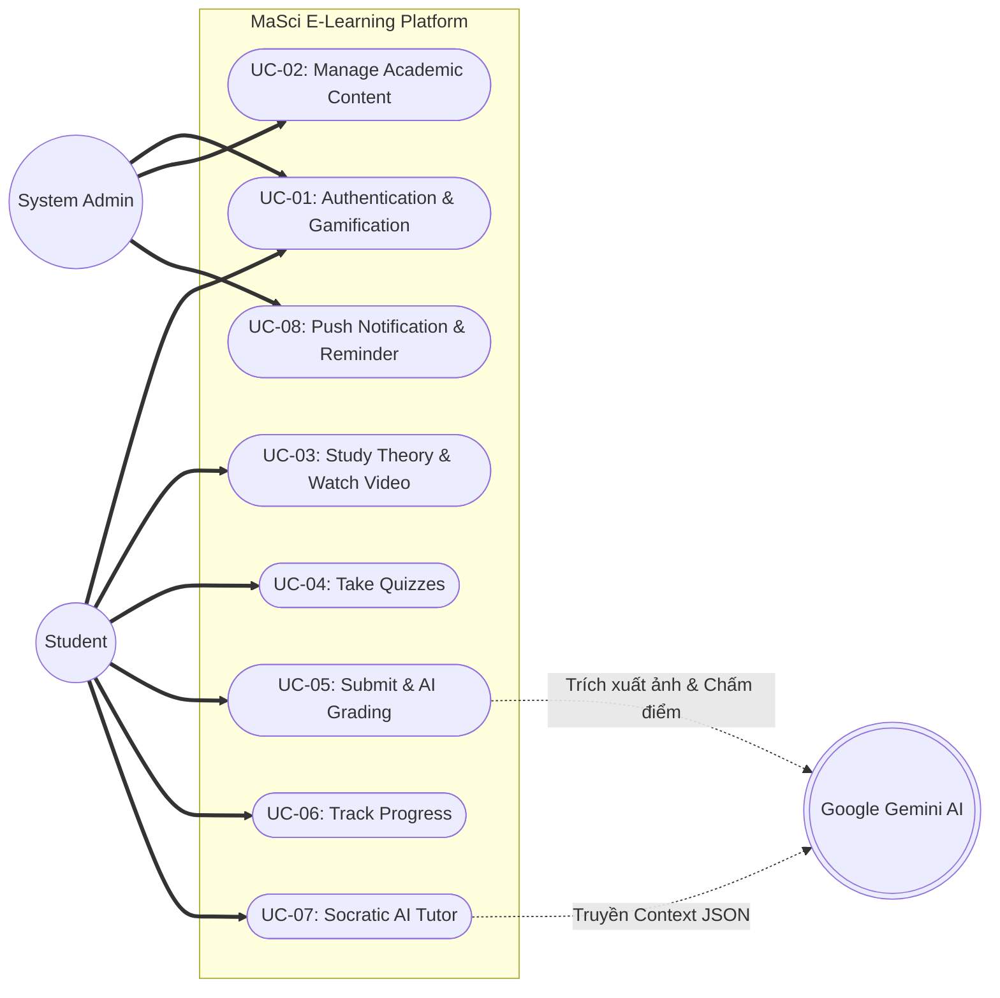
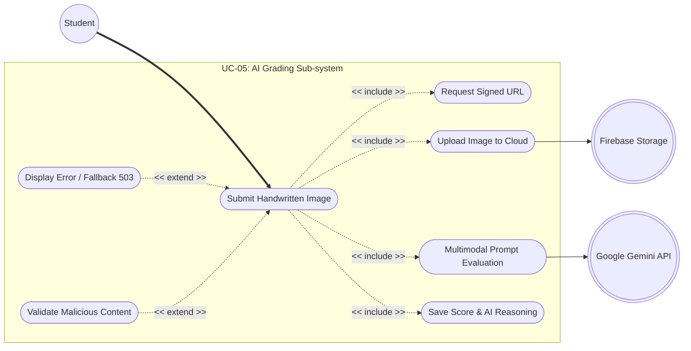
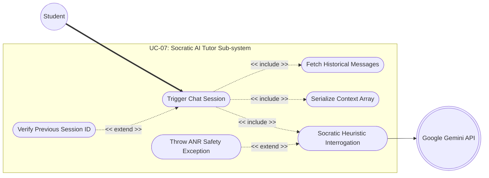

# MaSci E-Learning: Use Case Diagrams (Mermaid)

Dưới đây là mã nguồn (Source Code) bằng ngôn ngữ **Mermaid.js** để vẽ 3 sơ đồ Use Case khớp chính xác 100% với các vị trí (Placeholder) mà chúng ta đã dàn sẵn trong file `MaSci_Final_Report_V16.docx`.

Bạn có thể copy mã nguồn này, dán vào [Mermaid Live Editor](https://mermaid.live/) hoặc áp dụng công cụ Diagram tích hợp sẵn trong ứng dụng ghi chú như Notion/Obsidian để export ra file ảnh ảnh `.png` chất lượng cao và chèn trực tiếp vào Word.

***

### 1. Placeholder 1: `[INSERT OVERALL USE CASE DIAGRAM HERE]`
*Tương ứng: Figure 3.1: Overall System Use Case Diagram*

***

### 2. Placeholder 2: `[INSERT AI GRADING USE CASE IMAGE HERE]`
*Tương ứng: Figure 3.2: UC-05 Component Use Case Diagram*

***

### 3. Placeholder 3: `[INSERT AI TUTOR USE CASE IMAGE HERE]`
*Tương ứng: Figure 3.3: UC-07 Component Use Case Diagram*

***
**Lưu ý kỹ thuật cho ảnh dán vào Word:**
- Các Actor (`( )`) đóng vai trò kích hoạt nghiệp vụ.
- Đường gạch đứt màu đen `-.->` biểu thị chuẩn xác các quan hệ `<<include>>` (Bắt buộc phải chạy) và `<<extend>>` (Ngoại lệ chạy khi điều kiện xảy ra) trong đặc tả UML Use Case.
- Tất cả Actor đều được móc nối logic chính xác đến hệ thống bên ngoài là `Google Gemini` và `Firebase` như trong nội dung báo cáo Chương 3!
